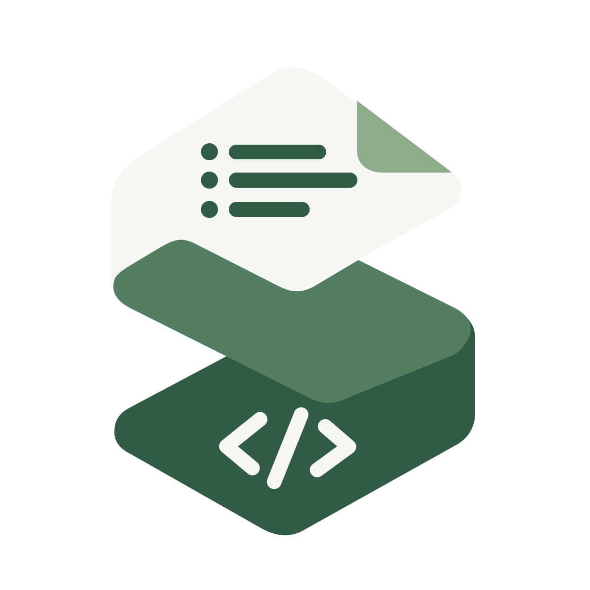

<p align="center">
  
</p>

# seampact

**Declare your API once in YAML. Get typed handlers, validators, OpenAPI and clients for your own framework.**

Read the documentation at **[jubasse.github.io/seampact](https://jubasse.github.io/seampact/)**.

[](https://github.com/jubasse/seampact/actions/workflows/ci.yml)
[](https://jubasse.github.io/seampact/)
[](LICENSE)
[](docs/getting-started/01-install.md)
[](docs/concepts/packages.md)
[](https://www.npmjs.com/package/@seampact/cli)

## Why seampact

- **One contract, no drift.** Types, validators, OpenAPI and clients all come from the same YAML.
- **Code you can read.** The output uses your framework's own mechanisms, in one `__generated__` folder.
- **Checked before your handler runs.** Input is validated and errors answer in one `problem+json` format.
- **Access at the boundary.** Every route states who may call it, and the app refuses to start without a hook for it.
- **Safe changes.** `seampact check` and `seampact diff` catch drift and breaking changes in CI.
- **Your tools keep working.** Swagger, Ajv and VineJS stay in place.

## What it generates

From one YAML contract:

| Output | What you get |
|---|---|
| Types | One TypeScript type per schema, request and reply. |
| Validators | zod, yup, class-validator, VineJS or Ajv schemas that check every input. |
| Server boundary | Routes for NestJS, Express, Fastify, AdonisJS, Hono, Spring Boot, Laravel, Symfony, FastAPI, Django REST Framework or Django Ninja. They validate input, call your access hooks, and check each reply against the contract before it is sent. |
| Built-in rules | Paging, rate limits, idempotency keys, ETags, CSRF, signed requests and field rights, declared in the contract and enforced at the boundary. You plug in the stores and decisions. |
| Errors | One error format, RFC 9457 `problem+json` by default, with typed error codes per route. |
| Clients | A typed `fetch` client, hooks for React (TanStack Query, SWR, RTK Query), composables for Vue (TanStack Query, Pinia Colada), an Angular service with NgRx effects as an option, and MSW mocks to test them with no backend. |
| Docs | OpenAPI 3.1 documents, and on NestJS, Fastify and FastAPI your framework's own Swagger kept in line with the contract. |
| Editor support | Schemas that complete and check the contract's names as you type. |

From the CLI:

| Command | What it does |
|---|---|
| `seampact init` | Starts a project: a config and an example contract. |
| `seampact generate` | Writes the code above into `__generated__`. |
| `seampact check` | Fails CI when generated files or documents differ from the contract. |
| `seampact diff` | Classifies the changes between two versions and fails on a breaking one. |
| `seampact lint` | Reports contract mistakes before you generate. |
| `seampact explain tasks.updateTask` | Prints one route whole: params, rules, errors, and where each one comes from. |
| `seampact bundle` | Packs a contract so other repositories, Node or JVM, pin and reuse it. |

## Example

### Contract

One YAML file describes the API:

```yaml
schemas:
  NoteId: { type: string, format: uuid }
  Note:
    type: object
    required: [noteId, title, createdAt]
    properties:
      noteId: NoteId
      title: { type: string, minLength: 1, maxLength: 100 }
      createdAt: { type: string, format: date-time }

surfaces:
  app:
    prefix: /v{version}
    access: { public: "Anyone may call this api: it has no accounts." }
    routes:
      notes:
        kind: collection
        id: { noteId: NoteId }
        item: Note
        ops: { get: {} }
```

---

### Backend

The handler you write, typed by the contract, in your framework:

<details open><summary>NestJS</summary>

```ts
@Controller()
export class NotesController implements NotesNest.NotesEndpoints {
  @NotesNest.getNote()
  getNote(@NotesNest.getNote.input() input: Notes.GetNoteInput) {
    const note = notes.get(input.path.noteId);

    if (note === undefined)
      return { status: Notes.Status.NotFound, code: Notes.ErrorCode.ApiNotFound };

    return { status: Notes.Status.Ok, body: note };
  }
}
```

</details>

<details><summary>Express</summary>

```ts
export const notesHandlers: NotesExpress.NotesEndpoints = {
  getNote(input) {
    const note = notes.get(input.path.noteId);

    if (note === undefined)
      return { status: Notes.Status.NotFound, code: Notes.ErrorCode.ApiNotFound };

    return { status: Notes.Status.Ok, body: note };
  },
};
```

</details>

<details><summary>Fastify</summary>

```ts
export const notesHandlers: NotesFastify.NotesEndpoints = {
  getNote(input) {
    const note = notes.get(input.path.noteId);

    if (note === undefined)
      return { status: Notes.Status.NotFound, code: Notes.ErrorCode.ApiNotFound };

    return { status: Notes.Status.Ok, body: note };
  },
};
```

</details>

<details><summary>AdonisJS</summary>

```ts
export default class NotesController implements NotesAdonis.NotesEndpoints {
  getNote(input: Notes.GetNoteInput) {
    const note = notes.get(input.path.noteId)

    if (note === undefined)
      return { status: Notes.Status.NotFound, code: Notes.ErrorCode.ApiNotFound }

    return { status: Notes.Status.Ok, body: note }
  }
}
```

</details>

<details><summary>Hono</summary>

```ts
export const notesEndpoints: NotesHono.NotesEndpoints = {
  getNote(input) {
    const note = notes.get(input.path.noteId);

    if (note === undefined)
      return { status: Notes.Status.NotFound, code: Notes.ErrorCode.ApiNotFound };

    return { status: Notes.Status.Ok, body: note };
  },
};
```

</details>

<details><summary>Spring Boot</summary>

```java
@RestController
class NotesController implements NotesEndpoints {
    @Override
    @GetNote
    public GetNoteResult getNote(GetNoteInput input) {
        Note note = notes.get(input.path().noteId());

        return note == null
                ? new GetNoteErrors.ApiNotFound()
                : new GetNoteResult.Status200(note);
    }
}
```

</details>

<details><summary>Laravel</summary>

```php
final class NotesController implements NotesEndpoints
{
    public function getNote(GetNoteRequest $request): GetNoteResult
    {
        $note = $this->notes->get($request->contractInput()->path->noteId);

        return $note === null
            ? GetNoteErrors::apiNotFound()
            : new GetNoteResponse200($note);
    }
}
```

</details>

<details><summary>Symfony</summary>

```php
final class NotesController implements NotesEndpoints
{
    #[SeampactOperation('getNote')]
    public function getNote(GetNoteInput $input): GetNoteResult
    {
        $note = $this->notes->find($input->path->noteId);

        return $note === null
            ? GetNoteErrors::apiNotFound()
            : new GetNoteResponse200($note);
    }
}
```

</details>

<details><summary>FastAPI</summary>

```python
class NotesHandlers:
    def __init__(self, notes: NoteRepository) -> None:
        self.notes = notes

    def get_note(self, request: GetNoteRequest) -> GetNoteResult:
        note = self.notes.get(request.input.path.note_id)

        return GetNoteErrors.api_not_found() if note is None else GetNoteResponse200(note)


bind_notes(app, handlers=NotesHandlerFactories(notes=notes_handlers))
```

</details>

<details><summary>Django REST Framework</summary>

```python
class NotesHandlers:
    def __init__(self, request: HttpRequest) -> None:
        self.request = request

    def get_note(self, request: GetNoteRequest) -> GetNoteResult:
        note = notes.get(request.input.path.note_id)

        return GetNoteErrors.api_not_found() if note is None else GetNoteResponse200(body=note)


# settings.py
SEAMPACT = {"notes": {"handlers": {"notes": "app.handlers.notes_handlers"}}}
```

</details>

<details><summary>Django Ninja</summary>

```python
class NotesHandlers:
    def __init__(self, request: HttpRequest) -> None:
        self.request = request

    def get_note(self, request: GetNoteRequest) -> GetNoteResult:
        note = notes.get(request.input.path.note_id)

        return GetNoteErrors.api_not_found() if note is None else GetNoteResponse200(note)


bind_notes(api, prefix="", handlers=NotesHandlerFactories(notes=notes_handlers))
```

</details>

---

### Schemas

The validators generated from the same `Note` schema. Pick one per app.

<details open><summary>zod</summary>

```ts
export const NoteSchema = z.object({
  // …
  title: z
    .string()
    .min(1, { error: "Expected at least 1 character." })
    .max(100, { error: "Expected at most 100 characters." }),
  // …
});
```

</details>

<details><summary>yup</summary>

```ts
export const NoteSchema = yup
  .object({
    // …
    title: yup
      .string()
      .strict()
      .min(1, "Expected at least 1 character.")
      .max(100, "Expected at most 100 characters.")
      .defined(),
    // …
  })
  .noUnknown()
  .default(undefined);
```

</details>

<details><summary>class-validator (NestJS)</summary>

```ts
export class NoteDto {
  // …
  @IsString()
  @MinLength(1, { message: "Expected at least 1 character." })
  @MaxLength(100, { message: "Expected at most 100 characters." })
  title!: string;
  // …
}
```

</details>

<details><summary>VineJS (AdonisJS)</summary>

A data tree the target reads at runtime to build the VineJS schema.

```ts
export const NoteSchema = vineStandardSchema({
  kind: "object",
  unknownKeys: "strip",
  fields: [
    // …
    {
      key: "title",
      optional: false,
      type: {
        kind: "scalar",
        base: "string",
        checks: [
          { rule: "minLength", limit: 1, message: "Expected at least 1 character.", native: true },
          { rule: "maxLength", limit: 100, message: "Expected at most 100 characters.", native: true },
        ],
      },
    },
    // …
  ],
});
```

</details>

<details><summary>Ajv JSON Schema (Fastify)</summary>

A plain JSON Schema; `seampactMessages` is the keyword that carries the contract's messages.

```ts
export const NoteSchema = ajvStandardSchema({
  type: "object",
  properties: {
    // …
    title: {
      type: "string",
      minLength: 1,
      maxLength: 100,
      seampactMessages: {
        minLength: "Expected at least 1 character.",
        maxLength: "Expected at most 100 characters.",
      },
    },
    // …
  },
  required: ["noteId", "title", "createdAt"],
});
```

</details>

<details><summary>Spring Boot (Java record)</summary>

A plain record with standard Jakarta constraints, for your own `@Valid`. The boundary checks the contract's rules (the title's length, the formats) before your controller runs.

```java
@JsonInclude(JsonInclude.Include.NON_ABSENT)
public record Note(@NotNull UUID noteId, @NotNull String title, @NotNull OffsetDateTime createdAt) {
}
```

</details>

<details><summary>Laravel (PHP class and rules)</summary>

A readonly class for the schema, and Laravel rules on each request in a generated `FormRequest`. The boundary runs them before your controller.

```php
final readonly class Note
{
    public function __construct(
        public string $noteId,
        public string $title,
        public DateTimeImmutable $createdAt,
    ) {
    }
}

// In GetNoteRequest::contractRules()
'path.noteId' => [
    'bail',
    new TypeRule($input, Position::Member, TypeRule::STRING, Presence::Required, Nullability::NotNull),
    'uuid',
    new FormatRule($input, Position::Member, FormatRule::UUID, BlankStrings::BlankOnly),
],
```

</details>

<details><summary>Symfony (PHP class)</summary>

A readonly class with Symfony Validator attributes, for your own `$validator->validate()`. The boundary checks the contract's rules on the raw JSON with a generated constraint before your controller runs.

```php
final readonly class Note
{
    public function __construct(
        #[Assert\NotNull]
        public string $noteId,
        #[Assert\NotNull, Assert\Length(min: 1, max: 100)]
        public string $title,
        #[Assert\NotNull]
        public DateTimeImmutable $createdAt,
    ) {
    }
}

// In GetNoteInputConstraintValidator::shape()
'noteId' => new Member(
    JsonType::String,
    checks: new Checks(format: Format::Uuid),
),
```

</details>

<details><summary>Pydantic (FastAPI, Django Ninja)</summary>

A frozen, strict Pydantic model. The boundary validates the input with it before your handler runs.

```python
class Note(_pydantic.BaseModel):
    model_config = _MODEL_CONFIG  # strict, frozen, extra="forbid"

    note_id: _seampact.WireUuid
    title: _typing.Annotated[str, _pydantic.Field(min_length=1, max_length=100)]
    created_at: _seampact.WireDateTime
```

</details>

<details><summary>Django REST Framework</summary>

A frozen dataclass for your code, and a generated serializer that checks the input before your handler runs.

```python
@_dataclasses.dataclass(frozen=True, slots=True, kw_only=True)
class Note:
    note_id: _uuid.UUID
    title: str
    created_at: _datetime.datetime


class GetNotePathSerializer(_drf_runtime.ContractSerializer):
    def get_fields(self) -> _drf_runtime.SerializerFields:
        return {"note_id": _drf_runtime.TypedValueField(_uuid.UUID)}
```

</details>

These are the default `rules: native` output, each library's own rules. `rules: seampact-consistent` gives the contract's exact checks on every library ([switch the validator](docs/configuration/validators.md)). What each library checks, and the error it answers, is in [Types and validation](docs/types-and-validation/README.md).

---

### Frontend

The typed client, for any framework or none:

<details open><summary>fetch</summary>

```ts
const client = createClient({ baseUrl: import.meta.env.VITE_API_URL });
const reply = await client.getNote({ path: { noteId } });

if (reply.ok) console.log(reply.body.title);
```

</details>

---

### Query

Hooks, composables and services over that client, for React, Vue and Angular. SWR, RTK Query, Pinia Colada, NgRx, NgRx Signals and a library-free mode work the same way: see [React](docs/frontend/react.md), [Vue](docs/frontend/vue.md) and [Angular](docs/frontend/angular.md).

<details open><summary>TanStack Query (React)</summary>

```tsx
const client = createClient({ baseUrl: import.meta.env.VITE_API_URL });
const Notes = createNotesHooks(client);

function NoteTitle(props: { noteId: string }) {
  const note = Notes.useGetNote({ path: { noteId: props.noteId } });

  if (note.isPending) return <p>Loading</p>;
  if (note.isError) return <p>{note.error.message}</p>;

  return <h1>{note.data.body.title}</h1>;
}
```

</details>

<details><summary>TanStack Query (Vue)</summary>

```vue
<script setup lang="ts">
// api.ts builds them once: createNotesComposables(createClient({ baseUrl }))
import { Notes } from "./api";

const props = defineProps<{ noteId: string }>();

const note = Notes.useGetNote(() => ({ path: { noteId: props.noteId } }));
</script>

<template>
  <p v-if="note.isPending.value">Loading</p>
  <p v-else-if="note.isError.value">{{ note.error.value?.message }}</p>
  <h1 v-else>{{ note.data.value?.body.title }}</h1>
</template>
```

</details>

<details><summary>Angular</summary>

```ts
@Component({
  selector: "note-title",
  template: `
    @if (note.isLoading()) {
      <p>Loading</p>
    } @else if (note.error()) {
      <p>{{ note.error()?.message }}</p>
    } @else {
      <h1>{{ note.data()?.body.title }}</h1>
    }
  `,
})
export class NoteTitle {
  readonly noteId = input.required<string>();
  readonly note = inject(NotesApi).getNote(() => ({ path: { noteId: this.noteId() } }));
}
```

</details>

<details><summary>NgRx (Angular)</summary>

```ts
store.dispatch(NotesActions.getNote({ request: { path: { noteId } } }));

export const noteReducer = createReducer(
  initialNote,
  on(NotesActions.getNoteSuccess, (state, { data }) => ({ ...state, title: data.body.title })),
  on(NotesActions.getNoteFailure, (state, { error }) => ({ ...state, error: error.message })),
);
```

Actions and effects are generated; the reducer and state stay yours.

</details>

<details><summary>NgRx Signals (Angular)</summary>

```ts
export const NoteStore = signalStore(withGetNote());

export class NoteTitle {
  readonly store = inject(NoteStore);
  readonly title = computed(() => this.store.getNote().data?.body.title);

  constructor() {
    void this.store.sendGetNote({ path: { noteId: "n1" } });
  }
}
```

</details>

The full walk-through is in [Get started](docs/getting-started/README.md).

## Supported stacks

### Servers

| Server | Versions | Validators |
|---|---|---|
| NestJS | 12 | zod, yup, class-validator |
| Express | 4, 5 | zod, yup |
| Fastify | 5 | zod, yup, Ajv |
| AdonisJS | 7 (6 still works but is no longer maintained, see [Supported versions](docs/supported-versions.md)) | zod, yup, VineJS |
| Hono | 4 | zod, yup |
| Spring Boot | 4 | generated checks, Jakarta constraints on the records |
| Symfony | 7.4, 8 | generated checks, Symfony Validator constraints on the inputs |
| Laravel | 13 (PHP 8.3 to 8.5) | generated `FormRequest` rules, Laravel's own value rules by default |
| FastAPI | 0.162 (Python 3.12 or later) | generated checks, Pydantic models, Pydantic's own value rules by default |
| Django REST Framework | 3.18, on Django 5.2 and 6 (Python 3.12 or later) | generated checks and serializers, DRF's own field arguments by default |
| Django Ninja | 1.5.3 and later, on Django 5.2 and 6 (Python 3.12 or later) | generated checks, Pydantic models, Pydantic's own value rules by default |

Spring Boot 4 is generated at build time by the Gradle plugin `io.github.jubasse.seampact` or the Maven plugin `seampact-maven-plugin`. It can also generate Spring Security matchers and refusals, and springdoc annotations. Laravel 13 is generated by `vendor/bin/seampact generate` (installed with Composer from Packagist) or `php artisan seampact:generate` (see [Laravel](docs/backend/laravel.md)). Symfony (PHP 8.3 to 8.5) is generated with `seampact/symfony`: see the [Symfony guide](docs/backend/symfony.md). FastAPI, Django REST Framework and Django Ninja are generated by `seampact generate` of the Python package (`pypi:seampact-fastapi`, `pypi:seampact-drf` or `pypi:seampact-ninja` in the entry's `use`, installed from PyPI): see the [FastAPI guide](docs/backend/fastapi.md), the [Django REST Framework guide](docs/backend/drf.md) and the [Django Ninja guide](docs/backend/ninja.md). The compiler binary comes with the `seampact-ir` wheel.

### Clients

| Framework | Versions | Query tools |
|---|---|---|
| Typed `fetch` client | any framework or none | none |
| React | 19 | TanStack Query 5, SWR 2, RTK Query 2, or none |
| Vue | 3 | TanStack Query 5, Pinia Colada 1, or none |
| Angular | 22 | none: a service over `HttpClient`, with NgRx 22 actions and effects or NgRx Signals 22 store features as an option |
| MSW mocks | 2 | none: handlers for `setupServer` and `setupWorker` |

When a version is supported, and when it is dropped: see [Supported versions](docs/supported-versions.md).

## Get started

- [Getting started](docs/getting-started/README.md): a notes API on the server of your choice, in four steps.
- [Server guides](docs/README.md#server-guides): one page per framework, from setup to tests, including [FastAPI](docs/backend/fastapi.md), [Django REST Framework](docs/backend/drf.md) and [Django Ninja](docs/backend/ninja.md).
- [Configuration](docs/configuration/config-file.md): every key of `seampact.config.yaml`.
- [Troubleshooting](docs/troubleshooting/README.md).
- [Coding agents](docs/getting-started/06-ai-agents.md): an `AGENTS.md` block, four skills, and `llms.txt` with one file per stack.

## Status

The reference contract runs end to end on every server above. Every package is on its registry, at one version:

```sh
npm install --save-dev @seampact/cli @seampact/codegen-ts
composer require seampact/laravel seampact/hooks
pip install "seampact-fastapi[generate]"
```

Gradle, Maven and the compiler binary are in [Install in other ecosystems](docs/getting-started/install-other-ecosystems.md). The [release notes](docs/release-notes/README.md) say what each release ships; the [1.0.0 notes](docs/release-notes/1.0.0.md) list what 1.0 refuses by name. See the [roadmap](docs/roadmap.md).

## More docs

Every page is listed in [docs/README.md](docs/README.md).

## Roadmap

- [x] Node servers: NestJS, Express, Fastify, AdonisJS, Hono
- [x] CLI: `init`, `generate`, `check`, `lint`, `diff`, `bundle`, `explain`, editor schemas (`compile --editor-schemas`)
- [x] Frontend: React hooks (TanStack Query, SWR, RTK Query, or no query library)
- [x] Frontend: Vue composables (TanStack Query, Pinia Colada, or no query library)
- [x] Frontend: Angular service over `HttpClient` (no query library)
- [x] Frontend: NgRx actions and effects for Angular
- [x] Frontend: NgRx Signal Store features for Angular
- [x] Frontend: MSW mocks
- [x] Java: Spring Boot 4, with a Gradle and a Maven plugin, Spring Security and springdoc
- [x] PHP: Symfony 7.4 and 8, with SecurityBundle and RateLimiter
- [x] PHP: Laravel 13, with Guards, Sanctum, Gates and Policies
- [x] Python: FastAPI 0.162 and later, Django REST Framework 3.18, and Django Ninja 1.5.3 and later
- [x] Documentation site
- [x] Standalone binary for five platforms, attached to each release
- [x] 1.0 on npm, PyPI, Maven Central, Packagist and the Gradle Plugin Portal
- [ ] 1.1: app input rules on the Node and PHP servers, API Platform, Next.js, an axios client, example apps
- [ ] An `init` wizard that creates a workspace of services and frontends, in any repository layout, from pinned templates
- Later: a client conformance suite (1.2), a kit to write new targets, one shared core per language, then Bun, Deno, Workers, Kotlin, Swift, Dart, Go, .NET, Rust ([full list](docs/roadmap.md))

## Contributing

See [CONTRIBUTING.md](CONTRIBUTING.md).

## License

MIT. See [LICENSE](LICENSE).
